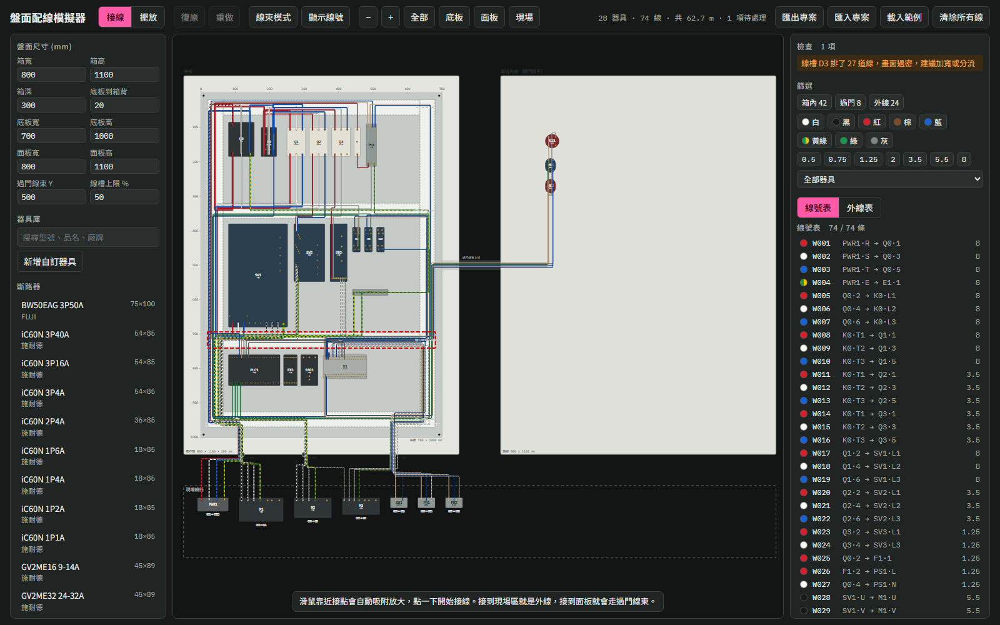

# 盤面配線模擬器

在瀏覽器裡排電控箱：放器具、點兩個接點選線徑顏色，線就會沿著線槽自動走好。圖面是 2D 等比例（單位 mm），用來先確認擺盤間距和配線，再動手做。



## 功能

- **接線：** 滑鼠靠近接點會自動吸附放大，點第一點、第二點後選線號、線徑和顏色；點選一條線時，兩端接點上的並線會淡淡亮起（端子台同一片的上下各點算同一個接點），右側列出並線可點選跳過去；沒有中繼點的線自動走線槽：從接點沿出線方向拉出器具外框再進線槽，不從器具本體上穿過；加了中繼點，線一定經過每個中繼點：接點到第一個中繼點、最後一個中繼點到接點照樣自動走線槽，中繼點與中繼點之間照點的位置直接連；中繼點點在線槽裡時，那條線槽沿中繼點的位置走，點在轉角附近時轉角就落在中繼點上。右側可「清除中繼點，改回自動」。線徑和顏色都可以臨時新增（重新整理後從選單移除，已接的線不變；專案用到的線徑會一直留在選單），新線徑的線寬與外徑依現有線徑表推算。
- **線號：** 每條線內部有自己的識別碼，線號只是名稱，可以重複（共點、同電位用同一個號碼）。建線時接點上已有線就預設沿用它的線號；改號時若同電位還有同號的線，可以一起改；整組複製時每個號碼換新，原本同號的複本仍同號。線號相同但電位不相連會警告（多半是打錯）；「同一電位有不同線號」的提示可在盤面設定開啟。線號表照線號排序，重複時警告與清單會加上兩端接點。
- **自動走線：** 依線槽路網找路徑，每條線分配獨立線道，可切換線束模式、依線徑或顏色篩選、高亮單條線。單條線可設定「不進線槽」直接拉線（例如動力線），可加中繼點調整路徑，不計入線槽占用。
- **說明：** 圖面左下角「? 說明」顯示目前操作的提示，不會自動跳出；遇到還沒看過的操作情況時按鈕上出現小紅點，點開看過就消失（記在瀏覽器），可「重設提示紀錄」。各面板與視窗標題旁的「?」可展開該處的說明。
- **器具外觀（實體圖／簡化圖）：** 操作設定可以切換，存在這台電腦的瀏覽器。實體圖的基本層（端子台底座、螺絲頭）依接點位置畫；有原廠外形圖或照片可以核對的系列另外畫把手、跳脫鈕、測試鈕、按鈕頭等細節，位置照原廠圖（見 docs/實體圖核對表.md），模擬時把手跟著 ON／OFF、選擇開關跟著位置轉。js/look.js。
- **檢視模式：** 標題列「檢視」（快捷鍵 V）只能看不能改：可平移縮放、點線或器具看資料、篩選、匯入專案、匯出與列印；拖曳、刪除、新增、復原與設定都停用。打開網頁時一律是檢視模式，要配線或擺放再切換。
- **檔案選單：** 「檔案…」裡有匯出專案、匯入專案、列印／PDF、載入範例。
- **左欄收合：** 左欄（盤面設定、器具庫）右上「«」可收合成窄條，窄條上有「器具庫」「盤面設定」按鈕。預設擺放模式展開、接線與檢視模式收合，各模式記住上次的選擇；收合或展開時圖面上的東西留在原位。手機寬度一律展開。
- **盤面設定：** 左側最上方「盤面設定…」開啟視窗，設定電控箱、底板和面板大小、面板模式與線槽上限；按鈕下方顯示目前尺寸。展開圖顯示底板、面板內側與現場區。
- **面板模式：** 「門板」會檢查面板是否蓋住箱體與關門碰撞；「獨立操作台」不檢查尺寸與碰撞；「不使用」會隱藏面板。
- **排盤：** 拖曳或輸入距離移動器具、線槽與出線口，可旋轉器具，選取後顯示上下左右的間距。
- **器具編號：** 擺放模式選取器具後，右側最上方「器具編號」可以改（例如 KA1 改成 CR-01），改編號不影響已接好的線；改成另一台正在用的編號時，可以一鍵把兩台的編號互換。
- **多選：** 擺放模式 Shift＋點加入或移出、Shift＋拖曳空白處框選、Ctrl＋A 全選；選取後可一起拖曳或用方向鍵移動、刪除、各自旋轉、複製（兩端都在選取內的線一起複製並配新線號），以及靠左／水平置中／靠右／靠上／垂直置中／靠下對齊與水平、垂直等距。
- **複製：** 擺放模式按住 Ctrl（Mac 用 Cmd）拖曳器具、線槽、出線口或現場區，就會拖出一個複本；選取後按 Ctrl＋C、Ctrl＋V 也能複製，滑鼠在圖面上時貼在游標處。鋁軌連軌上器具、現場區連區內器具一起複製，導線不複製。
- **附件：** LADN 輔助接點拖到電磁接觸器上會置中裝上（深度相加後再做深度與關門檢查）；MR-BAT6V1SET 伺服電池拖到伺服驅動器上會掛在下方。附件畫成半透明，之後跟著主體移動、複製，重疊不警告。按住 Alt 拖曳或在右側按「拆下」可以拆開。
- **DIN 軌：** 器具拖到 H-66 鋁軌上會以高度中心對齊軌道，並靠齊相鄰器具或軌道端點；按住 Alt 不吸附。移動鋁軌時，軌上的器具一起移動。伺服、濾波器、風扇、再生電阻和接地銅板不吸附。
- **檢查：** 提示器具彼此重疊、關門碰撞、線槽占用率超過上限。線道多到畫面上靠得很近只是顯示問題，不列入檢查，選取線槽時在右側說明。器具可以放在底板、面板、現場區以外（例如箱外板金），不會警告；線槽可以局部切除，器具壓到線槽也不會警告；完全在箱外的器具也不做深度與關門檢查。走線也會自我檢查：線沿原路折返時會列出來，並說明原因是中繼點、手動移過的剝線點、自動剝線點，還是程式走線不理想；外線穿過箱壁不是剛好一次（只從出線口）也會列出。
- **中繼點優先於出線方向：** 中繼點放在接點出線方向的反方向、而且在那個器具正後方時，線直接從接點往中繼點那邊出線，不先往外拉再繞回來；沒有中繼點的線照原本方向。線在中繼點前後沿原路折返時，檢查清單會提示移動中繼點。
- **線號位置：** 選取一條線後，可以把線號沿著線拖到想要的位置（線改路徑時跟著移）。線的詳細資料可選線號標在起點端、終點端、中間或兩端都標，選回來就取消拖曳過的位置。
- **二極體：** 器具庫有通用「二極體」（接點 A 陽極、K 陰極，本體畫二極體符號，旋轉也對），可以自己拉線接到任何地方；「二極體（線圈用）」拖到繼電器座或接觸器上會自動裝上、轉向，並自動接到線圈兩端（K 接 +、A 接 −，線號沿用線圈上已有的號碼），拆下時自動接的線一起移除。型號可以每台自訂，材料表照型號列，預設寫「二極體」。二極體接反、或接在 AC 線圈上，檢查清單會提示；線圈極性（A1／14 為 +）可在器具資料勾選對調。
- **全螢幕：** 標題列右邊的全螢幕按鈕（四角框圖示）可以隱藏瀏覽器的網址列和分頁，畫面更大；再按一次或按 Esc 結束。瀏覽器不支援時不顯示。
- **滑鼠操作（CAD 方式）：** 擺放模式左鍵拖曳空白處直接框選：由左往右拉是實線框，只選完全框住的；由右往左拉是虛線框，碰到就選。中鍵拖曳、或按住空白鍵＋左鍵拖曳平移畫面，滾輪縮放；手機、平板用手指拖曳平移。右上「操作設定」可以切回舊方式（左鍵拖曳平移、Shift＋拖曳框選），設定存在瀏覽器。
- **同電位器具：** 接地銅板（或名稱有「銅排、共點排、接地排」的自訂器具）所有接點本來就同電位，接在不同孔的同號線不會被當成打錯號碼；器具資料可以逐台勾選或取消「全部接點本來就同電位」。
- **電纜：** 右側「電纜」分頁的清單預設收起，每條電纜只顯示編號、芯數、長度與兩端器具，點開才顯示規格和每一芯（在圖上選到某一芯時，所屬電纜會自動展開）。可以新增電纜（箱內的隔離線、接到現場的外部電纜都可以），規格從電料清單選（每一種內建電纜的芯線名稱、顏色、線徑都是固定的，不從文字猜），或選「＋自訂規格…」開視窗自己填：規格名稱、芯數、線徑、有沒有隔離網、外皮顏色，再逐芯填名稱和顏色（可以一鍵填號碼 1、2、3…、常見色序，或把最後一芯改成黃綠 E）。自訂規格存在專案裡，同專案再建同規格的電纜直接從下拉選；電纜分頁最下面的「這個專案的自訂規格」可以編輯、改名、刪除（有電纜在用的不能刪）。電纜資料的「編輯規格…」可以逐芯修改這條電纜：內建規格會另存成自訂規格，自訂規格改了會套用到所有用它的電纜，已接的芯照原本的位置搬過去。舊專案用文字打的自訂規格，讀檔時會照那條電纜現在的芯線表登記成自訂規格。選取整條電纜按 Delete 會先問一次，可以選刪除或解散（芯線留成散線）。接芯線有兩種方式：在芯線表點一列、用下拉選單選兩端接點；或按「在圖上接芯線」（芯線表每一列也有「圖上接」）直接在圖上點兩個接點，一芯接完自動換下一芯；接線時圖上的工具列可以跳過這一芯、回上一芯或按「完成」，Esc 也能停止。沒接的芯列為備用。電纜每一端可以選「散線」或「接頭」：接頭（例如伺服編碼線插在驅動器 CN2、馬達 ENC）那一端不剝線，外皮直接走到接頭的接點，每一芯的這一端都是那個接頭，但各芯是接頭裡不同的腳位，電位和線號各自獨立；兩端都是接頭時不用接芯線，芯線表只當規格參考，電纜表每一芯列「接頭 → 接頭」；一端接頭時「在圖上接芯線」每一芯自動從接頭拉出，只要點另一端的接點。散線那一端可以先指定「兩端器具」（已接芯線的器具會自動列進來），之後編輯某一芯的接點只要從這兩側器具的接點裡選；「依序接…」選好 A、B 端的起始接點，還沒接的芯就依芯線表順序一次接到連續的接點。芯線表平常只顯示色點、芯名、線號與兩端，按「編輯」才能改芯線名稱、線號、顏色，勾選多芯可一次改顏色；依規格重設顏色、重排線號、新增一芯、解散或刪除電纜收在「⋯ 更多」；勾兩芯可以「互換接線」，展開某一芯可以「改接到另一芯」（芯線顏色不動，兩端接點與線號對調或搬過去）；「依芯線順序重排線號」可以連續編號或用前綴＋芯線名稱；外皮、路徑、剝線點等設定收在下方可展開的分區。電纜外皮預設畫成粗黑線（可改顏色），從 A 端剝線點走到 B 端剝線點；芯線只畫剝線點到接點那一段。拉芯線時（建線視窗或「在圖上接芯線」）放的中繼點，會放到電纜外皮上（外皮還沒有中繼點時）。選取電纜後雙擊外皮可以加中繼點、拖曳白點調整、雙擊白點刪除，也可以勾選外皮不進線槽；電纜本來就能走線槽外，外皮穿過其他器具不警告。剝線點（白色小方塊）預設自動放在最近的線槽裡，拖曳可以移動（移過的變黃色），在電纜資料可改回自動。外部電纜可填現場長度，材料表與線長統計的電纜長度＝外皮＋最長芯＋現場長度＋預留。舊檔裡外線上的電纜編號會自動組成電纜。
- **外線：** 從箱內接點接到現場區的接點時，建線視窗可以填電纜編號，會編進那條電纜（沒有就新建）的下一芯。裝在箱體外面的器具（例如箱頂的端子台、回生電阻）和箱內器具之間的線，也會經過出線口進出箱體。拉外線時點一下出線口，就指定這條線走那個出線口；現場設備（或箱外器具）可以設定「預設出線口」，接到它的外線和電纜都走那個。出線口（電纜固定頭、浪管接頭）可裝在箱底、箱頂、左右兩側，拖曳會吸到最近的箱面；選取出線口後可以用下拉改規格（尺寸），接好的線和電纜都保留；外線從出線口沿箱外繞到現場區。
- **現場區：** 可以新增多個現場區（例如依機台或區域分開），拖曳左上角名稱移動整區，區內器具一起移動；可改名、調整大小。外線表會列出現場端所在的現場區。
- **材料表：** 器具、線槽（含支數）、出線口、電線（依線徑與顏色）、電纜（依規格）。
- **線長統計：** 依線徑、顏色、種類與電纜統計條數與長度，可設定每條預留長度。
- **匯出與列印：** 線號表、電纜表、材料表、線長統計都能匯出 CSV；「檔案…→列印／PDF」會輸出全圖、底板、面板與每個有器具的現場區圖面（A4 橫向）和各表格（A4 直向），在列印視窗選「另存為 PDF」就是 PDF。
- **端子台端子號：** 選取 WAGO 2202 端子台後，右側每片一格填端子號（例如 R、S、T、101…），也能一鍵依序編號。端子號只用來顯示，改號碼不影響已接好的線；片數照樣可以增減。
- **端子台跳線：** 同一台端子台、接在不同片之間的導線（例如預留給選配緊急停止的 JP1）在電路圖上畫成元件：線上畫兩個端子符號（圓圈加斜線）、旁邊寫端子號，中間一段線標跳線的線號，所以跳線前後各段都標自己的線號。導線設定勾「預留跳線（拆下接選配）」時，跳線畫虛線、框一個「選配」虛線框並註明「拆下可串接選配」。端子台本身的短路片照舊當同一點，不畫。
- **端子台插入／刪除片：** 端子台設定面板可以「在第 N 片後插入 K 片」（0＝最前面）或「刪除第 N 片」。後面的片號、端子號、接在後面幾片的導線與電纜接頭、短路片一起移動；新插入的片端子號空白。插入位置在一組短路片中間、或要刪的片上有短路片時不做，請先拿掉短路片；刪除時接在那一片的線一起刪，可按復原。
- **短路片：** 選取 WAGO 2202-1401、2202-1201 端子台後，在右側「短路片」選上排或下排插槽、起始片與 2P～5P 加入；畫在端子台中間偏上或偏下，同一排不可重疊，上下排可以重疊；被接起來的幾片算同一個電位（並線亮起、線號檢查都會照算），材料表依規格統計 2002-402～405。重疊或超出片數會擋下或警告。
- **接線盒的短路片（同電位）：** 選取接線盒（TB-PG-10P、TB-PG-15P）後，在右側「短路片（同電位）」勾選要接在一起的接點（不一定要相鄰），按「設為同電位」；勾到已經在某一組的接點會併進那一組。同一組算同一個電位，建線時沿用線號、網路檢查都當成相通；圖上在接點內側畫紅色短路片，只從組內接點拉線上去，範圍重疊的組會往內錯開。
- **器具庫：** 內建施耐德、士林、三菱、台達、WAGO 等器具，可自訂或修改器具與接點。
- **現場區：** 擺放模式拖曳現場區的標題列可以移動，屬於這一區的現場器具、箱外線槽，以及接到這區器具的線和電纜的中繼點、剝線點會一起帶走。每個現場器具和箱外線槽都記住自己屬於哪一區（存在檔案裡），框跟框重疊、或框蓋到別區的器具時，拖走也不會搶走別區的東西。歸屬只在這些時候改：單獨拖器具或線槽放進另一區的框裡；選取現場區後按右側的「收進這一區」（框裡屬於別區的）或「歸到所在的現場區」（屬於這區但已經在框外的）。選取現場區時，屬於它的器具和線槽會框起來，框裡但屬於別區的用灰色虛線。新增現場區會自動放在箱子四周空的地方；現場區不能放在電控箱或面板上，拖過去放開會退回原位。選取現場區後，四角和四邊中點會出現小方塊，拖曳就能直接改大小（10 mm 格點，最小 120×80 mm）；改大小不會移動裡面的東西。
- **現場區走線方式：** 選取現場區後可以選「自動幹線」「照我放的箱外線槽」「直接拉」。自動幹線會在現場區面向箱子的那一邊（放不下就放在現場區和箱子中間）自動放一條看不見的幹線，畫面上是淡淡的虛線框；外線沿它排好線道再轉進出線口，不用自己放線槽，也不存檔、不算材料。新增的現場區預設用自動幹線；舊檔維持「照我放的箱外線槽」（沒放線槽就是直接拉），走法不會變。
- **箱外線槽（走線架、浪管）：** 線槽可以放在現場區或箱子外面，拖出箱外就自動變成箱外線槽（從器具庫新增時，畫面中央在箱外也會直接放成箱外線槽）。箱外有線槽時，順路的線會進線槽、排線道、沿線槽走，再轉進出線口；走線槽要繞太遠（超過直接拉的 1.3 倍再加 50 mm）或要穿過器具才進得了線槽的線，照原本直接拉，所以只有線槽附近的線會收進去。箱外線槽不檢查超出底板，只在壓到箱體時提醒；材料表一樣列在線槽裡。
- **拖線段：** 接線模式選取一條線（或電纜）後，滑鼠移到線槽外的一段上會出現雙箭頭（橫的段 ↕、直的段 ↔），按住拖曳整段平移，前後兩段自動伸縮。程式會在需要的地方自動放中繼點：同一段重複拖只會移動原本的點，放開後拿掉也不影響路徑的中繼點會自動清掉。接點出來的第一段、進接點的最後一段、線槽裡的段、穿過箱壁（出線口）的段不能拖；箱外的段拖不進箱子，箱內的段拖不出箱子。可以按復原。
- **插座的插頭點：** 軌道插座（CHNT AC30-124）和隆光 LK3214K 二連插座中間有一個「插頭」點，用來畫外部插頭插進插座的線；這種線本來就隨使用者拉，穿過其他器具不警告。
- **器具編輯器：** 「新增自訂器具」或器具資料的「編輯器具」會開啟畫布式編輯器。外形可選矩形、圓角矩形、圓形，填寬高（圓形填直徑）、深度、顏色、安裝位置（底板、面板、現場、箱外）。按「放接點」後在畫布上點一下就放一個接點，名稱照前綴與號碼自動往下編；「一次放一排…」指定數量、間距和靠哪一邊。選取接點可以拖曳（吸附 0.5～5 mm 格點）、方向鍵微調、Delete 刪除；選多個可以互相對齊（靠左、置中、靠右、靠上、靠下）、平均分布或照指定間距排、依序命名、設為同電位；「對齊器具」可以把選到的接點整組移到器具的左右中線、上下中線，或離器具上下左右邊緣指定距離（間距不變，選一個也能用）。單一接點可以改名稱、說明、出線方向（預設照靠近哪一邊自動決定）。編輯器內可以復原、重做。接點改名後，已接在舊名稱的線會改接到新名稱。器具庫裡的自訂器具旁邊有「編輯」「複製」「刪除」（有器具在用的不能刪；改過的內建器具是「換回原廠」）。
- **日光燈：** 「其他元件」裡的「日光燈」是通用燈具符號，不分電壓、瓦數，兩個接點，本體畫燈的符號；新增時預設放在箱外（畫面中央在箱外空白處就放畫面中央，否則放在箱子上方），接到箱內的線會經過出線口。
- **外部電源進線 3P4W：** 「現場：接線盒與其他」裡多一種 R S T N E 的電源進線（有中性線），4P 斷路器的 N 極可以直接接。
- **三相感應馬達：** 「現場：馬達」裡的「三相感應馬達」是通用器具，不分功率、廠牌，端子 U V W 與接地 E；模擬時 U-V 有電就算運轉；正式電路圖畫成 M 3~ 符號。另有「三相感應馬達 6 端子（Y-Δ）」：繞組端子 U1-U2、V1-V2、W1-W2 與 E，Y-Δ 啟動用；電路圖兩組端子各畫一個 M 3~（第二個標 U2 V2 W2），Y 接觸器的出線短接處標「星形接點（Y）」。
- **接點文字直寫：** 接點在上緣或下緣排成一橫排、文字寬到會和隔壁疊在一起時，那一排的接點文字整個字轉 90 度直寫；器具旋轉任何角度都一樣。端子台的端子號另有縮字規則，不套用。
- **配線審查（電氣檢查）：** 「檢查」清單會自動列出：器具已經接線但接地接點（PE、PE2、FG、E、⏚ 或說明有「接地」）沒接；接在接地的線不是黃綠或綠色（電纜芯線照規格不檢查）；接地和主電源（L、N、R、S、T、U、V、W）接在同一個電位；斷路器額定電流（從型號讀，例如 3P40A、9-14A 取上限）比接在它上面的線徑容許電流大（同一台、同一線徑合併一則）。線徑容許電流用盤內線槽配線的保守值，只當提醒：0.75mm² 約 7A、1.25 約 12A、2 約 17A、3.5 約 23A、5.5 約 31A、8 約 42A、14 約 61A。原本就有的線號檢查照舊：同號但不同電位一律提示，同電位不同號可在盤面設定開啟。
- **配線審查（審查流程）：** 右側清單的「審查」分頁：
  - 逐條確認：勾「已確認」（也可以選一條線，在右側勾「已審查確認」）；確認後線又改過（兩端、線號、線徑、顏色、電纜）會變成「改過要重看」。上方有確認進度。
  - 圖上註記：按「在圖上加註記」再點圖面，就放一個編號圓點；在分頁裡寫內容、改狀態（待處理紅、已修正橘、已確認綠），圓點可以拖曳，點一下會選到那則註記。
  - 列印審查報告：全圖（含註記圓點）加一頁清單：自動檢查的問題、所有註記、還沒確認的線，附版本號與日期，可以另存為 PDF。
  - 確認狀態與註記都存在專案檔裡。
- **動作模擬：** 上方「模擬」進入模擬模式（不能改配線；離開後狀態歸零，不存檔）。只模擬 ON／OFF 的邏輯導通，不算電壓降、電流、計時，也不跑 PLC 程式、不模擬通訊。
  - 起始狀態：所有斷路器 OFF、按鈕沒按、感測器沒觸發、PLC 輸出全部 OFF。
  - 點斷路器切換 ON／OFF；按鈕、感測器、極限、按鈕盒要按著才算按下（圖上或右側「按著操作」都可以，導線蓋在器具上也點得到）；右側點 PLC 輸出切換 ON／OFF，PLC 輸入用燈號顯示。
  - 有電的線依電位加光暈：DC ＋ 紅、0V 藍、AC 相線橘，沒電的線變淡；有電流的迴路加流動的虛線；滑鼠移到線上顯示是哪個電源的哪一極。動作中的器具綠框、按著的藍框、極性相反橘框、斷路器 OFF 灰框。
  - 「動作中」依器具類別分組（順序同材料表：斷路器、接觸器、繼電器、PLC…），組內照編號自然排序，每台寫出動作內容（線圈、保持、電源…）。
  - 偵測短路（＋和 − 或兩相接在一起，線變桃紅）、迴路一直切換停不下來（不穩定）、有極性的負載接反。
  - 線圈帶動的接點、自我保持、互鎖都會連鎖計算；安全繼電器 PNOZ 用簡化模型（輸入閉合＋重置後保持；S12–S34 短接是自動重置）。
  - 器具動作資料：內建器具已經設好（電源、斷路器、濾波器、接觸器與輔助接點、繼電器座、安全繼電器、FX5U 與 16EX、伺服驅動器電源、按鈕、急停、感測器、按鈕盒、插座、燈、風扇、雷射一組）；沒有動作資料的器具模擬時只當導線，右側會列出來。
  - 自訂器具：器具編輯器的「模擬動作」用下拉設定成組接點（一個接點代表多條線，例如 DC 5521 的 ＋／−、插頭的 L／N／E）、一直導通、斷路器、DC 電源輸出、AC 電源、負載（可設有極性）、線圈、接點（常開／常閉，線圈或按鈕帶動）、器具本身的電源、感測器輸出。從內建器具複製或編輯時會帶入原本的動作。
- **工具分頁（右側「工具」）：** 都從現有配線資料產生。
  - 線號標籤：每條線兩端各一張（線號、這一端的器具:接點、對端），可匯出 CSV 給標籤機，或直接列印成標籤格。
  - 端子台接線表：每個有接線的端子台一張，每片列出接的線與對端、短路片範圍，可列印貼在盤門內。
  - 24V 電源負載：用模擬引擎跑「最壞情況」（所有開關、接點、PLC 輸出都當作閉合），列出每個 DC 電源可能帶到的負載與合計電流，對照電源容量（80% 以上警告、100% 以上錯誤），線圈另列全部同時吸合的突入電流。內建電流只放原廠型錄查得到的值並附出處（TeSys BL 線圈 2.4 W、FX5 模組消耗電流、FX5U 24V 電源容量、DRL-24V120W 5 A…）；沒有資料的列出來，可以填實測值或銘牌值（同型號共用，存在專案的 loadMeas）。主機自己的輸入點接自己的 24V 不重複算（型錄容量已扣）；FX5 增設模組的內部 24V 算在主機，輸入迴路接外部電源時改算外部電源每點 4 mA。機械互鎖這類不會同時動作的負載也一起算，結果偏保守。
  - 版本比較：選一份舊版專案檔跟目前盤面比較，器具用內部識別碼對應、導線用兩端接點對應（改線號、線徑、線色算變更），列出新增／刪除／變更，新增的在圖上標綠、變更的標橘，可列印比較報告；舊檔只放在記憶體不存檔。
- **正式電路圖（工具分頁）：** 依配線自動產生 A3 橫式電路圖，符號照 IEC 60617，「預覽」看全部頁面，「列印電路圖（PDF）」選另存為 PDF。公司名稱可以填（顯示在封面與標題欄左邊，不填就不畫）；整份圖（符號與字）照 1.2 倍放大印在 A3 上，一頁放不下就自動分頁；PLC 每段 8 點（X0～X7、X10～X17），一頁上下兩段；伺服接線一台一欄；主回路太深時自動壓低層高，不會壓到標題欄；開關接開關的每一段都標線號：下面只接一台時直寫在那段線上，接好幾台時寫在分岔橫線上方（只往正下方走的相在橫線下方直寫）；伺服與其他接線頁：同一台器具上「短接」的端子（兩端子間直接拉線、器具上的短路片、內部相通；經端子台或別的器具才同電位的不算）歸成一組排在相鄰列，畫一條並聯線，有對外時從中間延伸一條線出去、對端合併寫一次（別頁畫過的同組端子灰字標「見第 N 頁」）；電箱外的中繼盒（接線盒，TB-PG 系列）畫成方框在中間、左邊電箱側、右邊外部側，短路片只在電箱側並聯；目錄超過 30 頁並排成兩、三欄；標題欄的專案名稱可以填（存在專案的 docTitle），不預設公司、簽核欄位。內容依序：
  - 封面與圖例、圖面目錄（沒有動作資料、只出現在表格裡的器具也列在目錄頁）。
  - 主回路：從 AC 電源沿著斷路器、保險絲、接觸器主接點追到用電器具（電源供應器、伺服、PLC 電源、風扇…），畫成樹狀，各相垂直線、分歧處畫分配線，每一層的分支照開關編號排（F101、F102…，不受用電器具編號或接線先後影響）；開關後面沒接用電器具（接到現場馬達的接觸器、預備斷路器）也畫出來，標「出線 → 接到哪裡」，正反轉接觸器出線並接時兩台各畫一支並註明；每一極的相別取靠電源的那一端（正反轉的相序對調看得出來）；斷路器／保險絲後面有接觸器、繼電器線圈的 AC 支路改畫成「控制回路 AC」展開圖（自保持、互鎖、指示燈都畫得出來），主回路只標「控制回路 → 第 N 頁」（指示燈經接點控制的也算；但那一點如果還接著主回路的其他負載，例如直接接在主斷路器後面，就留在主回路）；安全繼電器（PNOZ）輸入端子之間經過急停、門開關的迴路（含重置端子 S34 的手動重置按鈕），照實際接線找出配對、同一個接點只出現在一段，當成小段控制回路畫（上下線就是那兩個端子）；控制回路只取上下電源線之間的部分（N 相另外接到主回路的東西不會混進來）；積熱電驛的熱動元件畫在主回路；三相感應馬達畫成 M 3~，三相都走同一台開關（正反轉時另一台標並接）；斷路器沒接負載的備用極也畫出來；PLC 頁同一點接了好幾個器具時列出「＋其他編號」；同一個用電器具由兩條路供電（正反轉）時，主路徑以外的開關也畫一支並標「並接 → M1」；插座一律畫出來，插在上面的器具（插頭線接到插座口）畫在插座方框下方、標插頭線號；一個器具有幾組電源（例如伺服的主電源經 K1M、控制電源經 K0M）各自畫在自己的分支；伺服 U／V／W 接的馬達畫在下面；電源供應器標出 DC 輸出在第幾頁。單極開關沒切的相（例如 N）直接往下通過。分支太寬時（例如總開關 Q1 底下），把那台開關的負載側拉成第二組分配線、分支接著畫在同一頁右邊，放不下再換頁，新頁的分配線標明是哪台的負載側。
  - 控制回路：每個 DC 電源一段展開圖，＋ 與 − 是上下兩條電源線，中間的接點、線圈、負載、PLC 點做串並聯化簡後垂直畫出（自保持是並聯、共用的急停之類只畫一次），線圈與負載一律往下對齊，並聯的支路照負載編號排；二極體（線圈突波吸收）和線圈並聯畫出；同一器具共點相同的常開＋常閉（極限開關 C-A／C-B、繼電器 9-5／9-1）排在相鄰兩欄，畫成一個切換接點（1C），常閉從刀片右側拉到下一欄；線圈上方的接點位置清單同一頁的主接點合成一行，並預留高度不壓到其他字；多線式感測器畫成一個「感測器」方塊（棕接上方、藍接下方），黑／白輸出線從方塊右側直接拉到右邊相鄰的欄往下接 PLC 點（越遠的欄出線越高，線不交叉；換頁時整組一起換）；連接點只畫在三條以上線交會的地方，轉角不畫；空間夠時好幾個電源的小段放在同一頁；太寬時把中間電位拉成新的電源線（標線號）跨頁接續；化簡不完的橋接迴路改列每條路徑，重複的接點加 ＊。接點旁標器具編號（輔助接點、接點塊標示帶動它的器具）、端子號，線上標線號。
  - 伺服接線圖：每台伺服驅動器列出所有有接線的端子，拉到對端器具（線號、電纜編號；經過端子台時往後追到器具，0V、接地這種共用的寫到端子台為止）。光纖（CN1A／CN1B）畫虛線；U／V／W 收到馬達符號，馬達的煞車 B1／B2 等端子列在旁邊並標出煞車控制在第幾頁；兩端都是接頭的電纜（例如編碼器線，沒有芯線）也算接上，線上標電纜編號與規格；接馬達的各列排在一起；型錄有編碼器 CN2 卻沒有導線也沒有電纜接頭的，標紅字提醒（CN2L 線性編碼器是選配，不提醒）。
  - 其他接線：有接線、但哪一頁圖上都沒出現的端子（通訊板與 RS-485、網路、急停接安全繼電器、接線盒、濾波器、雷射轉接頭、二極體、光柵同步線…），用和伺服接線圖一樣的方式列出端子與對端；針腳位置固定的端子（D-sub 等，說明寫「第 N 腳」）標出腳位，例如 RD（2腳）；每個器具都畫成同樣的端子方塊（馬達收成馬達符號只用在伺服接線圖）；接地端子不列。
  - PLC 輸入、輸出：每頁上下兩組，每點一欄，上面是接的現場器具（按鈕、感測器、線圈…）與電源側線號，下面是 PLC 端子與位址，最後列共點接到哪裡。擴充模組沒有串接在主機旁邊（用擴充電纜接、或盤面上分開放）時，位址照盤面位置推定排在主機與已串接模組後面，頁上註明「位址推定」。
  - 端子台表（小的端子台合在同一頁）、線號表、材料表。
  - 每頁有欄號 1～10、列號 A～F、標題欄（專案、圖名、日期、產生的版本、頁次）；線圈下方列出它的接點在第幾頁第幾欄（∟ 常開、⊥ 常閉）。
  - 電源線名稱用那一點實際的線號（沒有線號才寫電壓），旁邊小字註明是哪台電源的哪個端子。
  - 畫法：IEC 60617（現行 JIS C 0617 與 IEC 60617 相同），控制回路電源線在上下、迴路垂直。（舊 JIS 習慣、水平畫法已拿掉；舊檔存的畫法選項讀檔時忽略。）
  - 文字完整、不重疊：器具名稱放不下就換行（靠下的負載名稱太長改寫在編號上方，型號剛好放不下先縮字不拆開），不截斷；文字放在符號外緣；測試會在瀏覽器實際排出每一頁，檢查文字和文字、器具方框／圓、線都沒有重疊（tests/schem-overlap.js）。
  - 正確性：測試會把畫出來的控制回路反推回每個接點、線圈的兩端，和配線比對必須完全一致。js/schem.js。
- **清單寬面板：** 右側清單（線號表、電纜、材料表、線長、審查、工具）標題旁的「⤢ 展開」把整塊清單移到盤面右邊的寬欄，盤面留在左邊照常看圖、點線，右側只剩器具資料、檢查、篩選；拖寬欄左緣調整寬度，「收回右側」放回去。展開狀態與寬度記在這台電腦的瀏覽器。分頁按鈕列捲動時固定在上方。js/wide.js。
- **接點別名：** 選取內建器具，右側「接點別名」可以依公司習慣改接點的顯示名稱（例如 A1 改成「線圈+」）；線還是接在原本的接點上，器具的尺寸、動作、模擬都不變，清單、提示、圖上都顯示別名。端子台不用別名，請用片上標籤。
- **自訂器具：** 器具庫裡標「自訂」，選取時右側提示「未核對」，編輯器上方也會提醒：尺寸、接點、動作都是自己設定的，程式不會核對，模擬只照「模擬動作」的設定計算。編輯內建器具存檔就會變成自訂器具；只是想改接點名稱的話，端子台用片上標籤、其他器具用接點別名。讀檔時，和內建器具完全一樣的自訂器具（舊版留下的複本）會自動換回內建。器具庫「自訂器具」標題旁的「清理沒用到的」列出沒有器具在用的自訂器具，勾選後刪除（可以復原）。
- **清除：** 「清除…」選單可選只清除線、清除器具和線，或全部清空（含線槽與出線口）；確認後才刪除，可按復原。箱體尺寸、面板設定、現場區與自訂器具都會保留。
- **放置器具（像 CAD 插入圖塊）：** 點器具庫的器具後，預覽跟著滑鼠移動，點一下放下（放一台就結束）。移動時和拖曳一樣吸附 5 mm 格點、鋁軌、正面附件的主體、Q 系列基板的空槽（預覽上標示裝到哪一槽與位址；不能放時變紅）。R 旋轉、Esc 或右鍵取消，放置中可以滾輪縮放、中鍵或空白鍵拖曳平移；觸控是點一下放下。選取基板時點 Q 模組則直接裝到第一個空槽。
- **底座插槽（三菱 Q 系列）：** 基板記住電源槽、CPU 槽、I/O 槽的位置；從器具庫把模組拖到基板上會吸到最近的空槽（種類不對或已佔用就放不進去），移動基板時模組一起移動，拖離基板就拆下。選取基板時，右側「槽位」表列出每一槽裝了什麼與 I/O 位址，空槽可以直接選模組裝上；選取基板時點器具庫的模組也會裝到第一個空槽。I/O 位址依槽位自動編號（0 槽 X00～X0F、1 槽 X10～…，空槽算 16 點），圖上接點、線號表、模擬的輸入輸出清單都顯示實際位址。台達 AH 背板也適用（位址規則不同：X、Y 各自連續、只算數位模組，格式 X0.0～X0.15）。擴展基板可以在右側設定接在哪個主基板與擴展級數，位址接在主基板後面。超薄型基板只能裝 Q61SP，冗餘電源基板有兩個冗餘電源槽。
- **接觸器附件（士林）：** TH-P 熱電驛拖到接觸器下方會裝上，主迴路和接觸器的 2/T1… 自動接通；AP 輔助接點可疊在正面或貼在右側。S-2×P 可逆組放下時左右自動各放一台接觸器，三台一起移動，模擬時兩台不會同時吸合。模擬模式點熱電驛會跳脫（95-96 打開、97-98 閉合），再點一下復歸。
- **往右／往左串接（三菱 FX5、FX3U；台達 AS、AX-3、DVP）：** 擴充模組拖到主機右邊會一台貼一台串起來（左側轉接器串在左邊），可以插到中間，拖離就拆下，刪除會往前補位；移動主機整串一起動。位址依串接順序自動編號（8 進位、每台以 8 點為單位，例如 FX5U-32M 的第一台擴充從 X20 開始），圖上接點與模擬都用實際位址。台達 AS／AX-3 用「字.位元」：主機內建點佔第 0 字，每台數位模組佔 ceil(點數/16) 個字（AS16AM10N 接在主機後面是 X1.0～X1.15），類比與特殊模組不佔；AS-PS02 電源模組裝在主機左側，有電時主機也算有電。DVP-SV3／SX3 擴充從 X20／Y20 開始，ES3／EX3 接在主機點數後面。
- **接點文字自動排：** 每台器具的接點文字自動找不會擠在一起的位置：同一排（上下緣）或同一欄（左右緣）的接點一起決定寫法，橫排依序試橫寫、斜寫 45°、直寫，放不下就縮小字或寫在接點外側出線旁邊；直欄先寫在內側，兩欄面對面時改寫到外側。同名相通的接點（S/S(2)、COM(4)）圖上照板子印字顯示 S/S、COM。器具編號也會避開這些文字和連接器方框。
- **連接器（接頭）：** 牛角、MIL、D-sub、FX 的 20 針連接器等，整個連接器在圖上只算一個接點（CN1、CN2，畫成針腳範圍的虛線框），針腳收在裡面；詳細資料的「連接器」可以展開針腳表，看每支針腳的訊號（實際位址）和接到哪裡。接線模式從連接器拉到另一個連接器就是排線（一條粗線，模擬照針腳一一對接）；拉到一般端子時，建線視窗會問接哪一支針腳，線接在單一針腳上（接點名稱顯示 CN1-B20），圖上從連接器那一點出去。舊檔的排線（一束芯線）與接在針腳上的線，讀檔時自動換成新寫法。螺絲端子台、脫落式端子台照舊一顆一個點。
- **排線與牛角轉接座：** 選取轉接座（柏叡牛角轉接座、三菱 A6TB），右側「接排線」列出畫面上同針數、還沒接排線的 PLC 模組連接器（廠商指定適用的排前面；兩個牛角的型號可以分別接），按下就建立一條排線，模擬訊號會穿過排線與轉接座；排線不走線槽。圖上端子照轉接座板上的印字顯示（配線看的）；右側「端子 → PLC 點位」對照表依排線自動推算每個端子對應的實際點位（含基板槽位位址），可以手動填字蓋過（轉接座不一定接 PLC），清空恢復自動。
- **存檔：** 自動暫存在瀏覽器，也可匯出、匯入 JSON 專案檔。

## 使用方式

不需要安裝或編譯。下載後直接用瀏覽器開啟 `index.html` 即可，也可以用本機伺服器：

```bash
python -m http.server 8000
```

然後開啟 <http://localhost:8000>。

### 走線測試

修改走線相關程式（`js/routing.js` 等）後先執行 `node tests/route-check.js`；修改介面後執行 `node tests/layout-check.js`，在手機到桌機寬度下打開各種選單與視窗，檢查有沒有超出畫面。走線測試：

```bash
node tests/route-check.js
```

會在固定情境（範例電控箱、T 字接法線槽、旋轉器具、附件、側面出線口、箱內隔離線與外部電纜、出線口四面進出（現場區在箱子上方或下方）等）檢查每條線：沒有警告的線不可穿過其他器具、自動路徑照接點方向出入線、手動路徑經過每個中繼點、不可來回折返；電纜的芯線要接到剝線點，芯數與長度要正確。後面可以再加專案 JSON 檔一起檢查。全部通過才發布。

另外用隨機配置測試防止同類問題換個配置又出現：

```bash
node tests/fuzz-check.js
```

會產生 150 組隨機配置（箱子大小、現場區位置、出線口、線槽、箱外線槽或自動幹線、器具、線、電纜、中繼點），檢查每一條路徑：不可沿原路折返（中繼點造成的不算）、外線只能從出線口穿過箱壁一次、座標正常；繞路只列出參考。目前已知的電纜特例有上限，數字只能更少，變多就算失敗。`node tests/fuzz-check.js 300 1000` 可以換一批種子多測。

```
node tests/zone-check.js
```

現場區歸屬檢查：框重疊時不搶走別區的器具、單獨拖器具改區、收進這一區、存檔讀回後歸屬不變。

```
node tests/review-check.js
```

配線審查檢查：接地沒接、接地線色、斷路器線徑、確認後改過要重看、註記存檔讀回、審查報告。

```
node tests/tpl-data-check.js [系列]
```

器具庫資料檢查：每個內建器具的接點在外框內、名稱不重複、不重疊，動作資料指到的接點都存在，PLC 的 X、Y 都分到共點。

```
node tests/plc-sim-check.js [器具 id 片段]
```

PLC 實際模擬檢查：每一種有輸入輸出動作資料的內建器具都真的接上電源和線跑模擬；每個 X 接到共點的另一極要 ON、拔掉共點要 OFF；每個 Y 逐點接一顆繼電器線圈，ON 時要吸合、OFF 時不吸合、不能短路。沒有自己電源的模組（增設模組、轉接器、基板上的 I/O）裝到對應的主機或基板（含電源模組）上測，上游斷電時輸入要全部 OFF、輸出不動作、模組標示沒電；CPU → 有電源的擴展單元 → 模組時，模組吃擴展單元的電；CPU 沒電時 CPU 的輸入不亮。

```
node tests/chain-check.js
```

串接檢查：FX5、FX3U、DVP、台達 AS／AX-3 擴充模組串到主機右邊、左側轉接器與電源模組、插到中間、拖離、刪除補位、移動主機、位址依順序（8 進位或字.位元）、存檔讀回、模擬用實際位址。

```
node tests/shihlin-check.js
```

士林接觸器檢查：TH-P 熱電驛裝在接觸器下方自動導通、跳脫／復歸（手動與自動）；S-2×P 可逆組放下自動帶兩台接觸器、三台一起移動、機械互鎖、審查提醒電氣互鎖；AP 上裝式與側裝式輔助接點跟著接觸器動作；存檔讀回。另外檢查士林斷路器：NF／NV／BH／NVB 數量、同框架不同型式的外形、4P 左極 N、3P 框架的 2P、NVB 1P 2 線式與 1P+N；模擬 NF 主迴路、NV 4P 的 N 極導通、按「測試」漏電跳脫與復歸。

```
node tests/tesys-check.js
```

施耐德 TeSys 檢查：LRD／LR9D 插在 LC1D 下方（只能裝型錄對照表上的機種）、主迴路經 GV2P、接觸器、熱電驛接通、跳脫與復歸；LC1DT200A 四極；LC2K 兩組線圈互鎖與內部換相；LC2D 自動接好原廠線；LADN 跟著接觸器、GVAE／GVAN 跟著斷路器；存檔讀回。

```
node tests/idec-check.js
```

IDEC YW 檢查：標準組合放下自動裝好 ①②③ 接點塊、拆裝、緊急停止不能裝雙接點塊；裝上後端子照位置編號（13-14、21-22…）；刪除本體時附件一起刪（YW 接點塊、PLC 模組、熱電驛）並跳出提示、可以復原；模擬按鈕瞬時／交替、緊急停止、選擇開關點左半邊／右半邊與彈簧復歸、照光燈；存檔讀回。

```
node tests/idec-sim-check.js
```

IDEC YW 完整模擬：206 種操作部逐一放下，每個接點塊的每個接點在每個位置／狀態下接繼電器模擬，和型錄接點動作表比對（3 位置 13 種接點結構）；各種復歸方式的點擊、照光燈、雙接點塊兩個接點、緊急停止不能裝雙接點塊。

```
node tests/schem-check.js [使用者專案檔.json]
```

正式電路圖檢查：隨機電路 40 組（tests/schem-fuzz.js 固定種子產生：主回路、AC 控制、正反轉、插座、24V 控制、PLC、感測器、端子台中繼），每組都要圖和配線一致、沒有重疊與截斷、有接線的器具都畫得出來；伺服接線圖（光纖、馬達、兩端接頭的編碼器電纜、沒接的編碼器）；其他接線頁與針腳腳位；插座與插在上面的器具；沒接負載的出線；AC 控制回路展開圖；安全繼電器輸入迴路；正反轉＋積熱電驛的主回路；三相馬達與並接；切換接點；二極體畫在控制回路；三線式感測器畫成一個方塊、輸出線從方塊拉出；器具名稱完整不截斷；文字重疊（測試電路與使用者專案、IEC 垂直與舊 JIS 水平都要 0 處）；頁面組成與 A3 圖框、頁次、沒有殘留的佔位符號；控制回路從圖反推回每個元素的兩端，和配線完全一致；自保持畫成並聯；線圈下方的接點頁欄；主回路電源供應器標出 DC 輸出頁；很寬的迴路拉出中間電位跨頁仍一致；專案名稱存檔；預覽。給專案檔時也用那份檢查一致性。

```
node tests/cover-check.js [種類]
```

器具覆蓋測試：每種器具照它的動作資料自動套 3 種電路（tests/cover-gen.js），產生正式電路圖並檢查不能出錯、圖反推和配線一致、沒有截斷與重疊、有接線的器具都畫得出來、受測器具不會掉到「其他接線」頁、附件有裝上。目前做完的種類：misc（伺服驅動器＋馬達＋編碼器線＋光纖、AC 電源、雜訊濾波器、DC 電源、感測器、風扇、燈 33 種，99 個組合，並檢查光纖畫虛線）；nosim（沒有動作資料的器具 39 種，117 個組合：接到燈，檢查會列在「其他接線」頁）；plc（PLC 主機、串接模組、插槽模組＋底板、連接器模組 491 種，1479 個組合：輸入全接按鈕、輸出全接繼電器、串接兩台／插滿槽；另外檢查每一點都有位址、同系統位址不重複）；panel（面板按鈕、照光按鈕、選擇開關、IDEC 操作部照標準組合裝接點塊與 FA 轉接器、人機、面板插座 216 種，648 個組合：DC、AC、接 PLC 輸入）；tb（端子台、接地排、牛角轉接座 175 種，525 個組合：控制回路與主回路經過端子台、兩台牛角座用排線對接，並檢查列在端子台頁）；relay（繼電器、計時器、固態繼電器（單獨放與裝在散熱座）、PNOZ 安全繼電器 18 種，54 個組合）；mc（電磁接觸器、一體式正反轉 LC2K、正逆轉組 LC2D／S-2×P、積熱電驛、輔助接點 213 種，637 個組合：DC 線圈＋主回路馬達、AC 線圈自保持、裝附件或經端子台）；brk（斷路器、漏電斷路器、馬達保護器、保險絲座 796 種＋輔助／警報／分激／欠電壓附件，每種裝在 3 種主體上，共 2433 個組合）；組合 1 主回路接負載（三極以上接三相馬達、有 N 極再接燈）、組合 2 保護 AC 控制回路（停止、啟動、自保持繼電器、指示燈）、組合 3 上游有主斷路器、只用第一極（其餘備用極）餵 24V 電源並裝附件、附件接點接指示燈。

```
node tests/jbox-check.js
```

同一台短接與接線盒畫法：TB-PG 接線盒（3 種組合）畫成方框在中間、左邊電箱側、右邊外部側，短路片只在電箱側並聯拉一條線回電箱、外部側每腳各自拉線；所有有 COM 與 S/S／0V 的 PLC 主機做 S/S–0V 短接、COM 串接，畫成一條並聯線加一條延伸線；伺服短路片直接接起來、沒對外時不拉延伸線；一般現場器具（一體化馬達、感測器…）同一腳接電箱又串到另一台時照一般畫法、不畫成兩側。每個案例檢查不出錯、圖和配線一致、不重疊、沒有截斷。

```
node tests/tbslice-check.js
```

端子台跳線與插入／刪除片：所有可設片數的端子台（25 種）× 一般／預留跳線，跳線串在控制回路、也經過主回路一相，檢查畫出跳線、端子符號、線號、選配框，圖和配線一致、不重疊；另外各測插入、插在最前面、刪除、插在短路片中間或刪有短路片的片要擋下，檢查片數、端子號、接線、短路片跟著移，另外用畫面按鈕操作插入、刪除與復原。

```
node tests/tend-check.js
```

天得器具檢查：數量、廠牌系列與資料來源；端子台長度照型錄公式、每片上下同電位、短路片；雙層端子台上下層各自獨立；保險絲座導通；TSSR 輸入有電時 1-2 導通、D 型接反顯示極性相反；SSR 吸附到散熱座最近的空位置（散熱座不會被當成 PLC 基板）；TFB-101N 只能疊在 TFB-101／TFBR-101 正面。

```
node tests/gtwin-check.js
```

富士 G-TWIN 檢查（無熔絲 BW、漏電 EW）：型號數量與尺寸、2P（3P 框架拿掉中間極）與 4P 端子位置；內部附件拖到斷路器上自動貼在左側或右側、一側一個；主迴路導通、輔助開關跟著 ON／OFF、警報開關跟著跳脫、分激脫扣有電跳脫、欠電壓脫扣沒電跳脫且合不上、跳脫後點一下復歸；存檔讀回、刪除斷路器時附件一起刪；EW 的型號與尺寸（EW100 2P 用 3P 框架）、按「測試」漏電跳脫、漏電警報開關 71/72/74 只對漏電跳脫動作且只裝 EW125 以上。

```
node tests/look-check.js [--write]
```

器具實體圖檢查：每一種器具在實體圖、簡化圖都畫得出來；細節層（把手、按鈕…）每個系列都有資料來源，畫在本體內、不蓋到接點；4P 把手在右邊三極中間；模擬時把手跟著 ON／OFF、選擇開關跟著位置；簡化圖不畫實體元素。加 `--write` 重新產生 docs/實體圖核對表.md（逐型號列出細節層與資料來源，或只有基本層）。

```
node tests/tools-check.js
```

工具分頁檢查：線號標籤張數與內容、端子台接線表（每片接線、短路片）、電源負載用小電路手算對照（LC1D09BL 100 mA＋FX5U 輸入 5.3 mA＝105.3 mA、填實測值後 150.3 mA、80%／100% 門檻、FX5U 容量 400 mA 與 16EX 內部 85 mA、自己的輸入點不重複算、讀檔只留合法實測值）、版本比較（新增、刪除、移動、改線號算變更、圖上標示）、寬面板展開與收回。

```
node tests/label-check.js [器具 id 片段]
```

接點文字檢查：每一種內建器具的接點文字不能互相疊在一起、不能壓到別的接點、不能超出器具外框（文字位置由程式自動決定，這裡用同一套範圍框檢查）；旋轉 90° 只列出參考。

```
node tests/adapter-check.js
```

轉接座與連接器檢查：柏叡各系列與三菱 A6TB 轉接座用排線（一條線接兩個連接器）接到裝在基板上的 QX41／QY41P，逐點模擬確認每個端子只觸發對應的實際點位（X10～X2F、Y30～Y4F），對照表的自動點位和模擬一致；QX42 兩個連接器、手動點位、存檔讀回；散線接在單一針腳的模擬、建線視窗選針腳、連接器對連接器建排線；舊檔的一束芯線排線讀檔轉換。

```
node tests/place-check.js
```

放置檢查：預覽跟著滑鼠、格點吸附、R 旋轉、點一下放下與編號、復原、Esc／右鍵取消、中鍵平移不會放下、正面附件與 Q 槽位吸附、槽滿不能放、觸控點一下放下、切換模式取消。

```
node tests/rack-check.js
```

底座插槽檢查：模組吸到槽位、槽種類與佔用限制、跟著基板移動、I/O 位址依槽位編號、槽位表、存檔讀回、深度、模擬用實際位址。

```
node tests/tpl-check.js
```

器具資料檢查：和內建一樣的自訂器具換回內建、清理沒用到的自訂器具、接點別名、自訂器具提示。

```
node tests/smoke-check.js [專案.json …]
```

整體冒煙測試：讀檔與存檔讀回、四種模式、清單分頁、匯出、列印、選取每台器具／每條線／每條電纜、復原、器具編輯器、動作模擬，沒給專案檔就用內建範例。

```
node tests/sim-check.js
```

動作模擬檢查：斷路器、自我保持、停止按鈕、感測器到 PLC 輸入、PLC 輸出到繼電器、AC 燈、雷射一組（成組接頭）、極性相反、短路、自訂器具動作資料。

### 發布到 GitHub Pages

每次修改後先執行 `python3 scripts/bump-version.py` 再推上去：它會更新 `index.html` 裡 css/js 網址後面的版本號，避免瀏覽器拿到快取的舊檔；版本號是發布當下的時間戳（秒），也會顯示在左側面板。


1. 把這個專案推到 GitHub。
2. 到 repository 的 **Settings → Pages**。
3. **Source** 選 **Deploy from a branch**，分支選 `main`，資料夾選 `/ (root)`，再按 **Save**。

## 專案結構

```text
index.html         頁面結構
css/style.css      樣式
js/inventory.js    不畫成器具的電料清單（品名、規格、型號、品牌）
js/devices.js      基礎資料與器具庫（尺寸、接點）
js/devices-fx5.js  三菱 FX5 系列器具
js/devices-fx3.js  三菱 FX3U／FX2N 系列器具
js/devices-q.js    三菱 Q 系列器具（底座插槽式）
js/devices-bore.js 柏叡牛角轉接座
js/devices-ah.js   台達 AH500 系列器具
js/devices-dvp.js  台達 DVP-ES3／EX3／SV3／SX3 主機
js/connectors.js   連接器：把連接器的針腳收成一個接點（CN1），排線、散線接單一針腳、針腳訊號查詢
js/devices-ser.js  原本內建器具的系列分組（器具庫依「廠牌 系列」收合）；隨機配置測試固定用的器具組
js/devices-idec.js IDEC YW 系列：操作部＋可拆裝接點塊
js/devices-gtwin.js 富士 G-TWIN 無熔絲斷路器 BW32～BW800、漏電斷路器 EW32～EW800（每個框架 × 極數 × 電流一種）＋內部附件（輔助、警報、分激、欠電壓、漏電警報，裝在左右側）
js/devices-tend.js  天得：保險絲座（TFBR-32、TFB、TFE、面板式 TFB-15、TFB-101N 指示燈）、端子台（TBC／TBCN／TBR／TBRN／TBS 可選片數＋短路片、TBD 雙層、TB 固定式、T20／T40 單柱）、TSSR 固態繼電器 A／D 型＋TSSR02 散熱座、TSSR03 固定座（SSR 用插槽吸附）
js/devices-acti9.js 施耐德 Acti9 iC60N 斷路器
js/devices-tesys.js 施耐德 TeSys：LC1D 接觸器、GV2 馬達保護、LRD／LR9D 過電流繼電器
js/devices-shihlin.js 士林 S-P 接觸器、S-2×P 可逆組、TH-P 熱電驛、AP 輔助接點
js/devices-shihlin-brk.js 士林斷路器：NF 無熔線、NV 漏電、BH 分電盤用、NVB／NVP 住宅用漏電（照外形組 × 框架 × 極數 × 電流）
js/devices-as.js   台達 AS 系列（主機、數位 I/O、類比、特殊模組、電源、功能卡）與 AX-3 主機
js/devices-chain.js 三菱 FX5、FX3U 的串接設定
js/sample.js       範例電控箱
js/state.js        專案狀態、暫存、復原
js/routing.js      線槽路網與自動走線
js/render.js       SVG 繪製
js/panels.js       左右面板與檢查清單
js/popup.js        建線彈窗
js/cable.js        電纜資料：規格解析、芯線、剝線點自動位置
js/cables-ui.js    電纜分頁、芯線表、在圖上接芯線、剝線點拖曳
js/report.js       材料表、線長統計、CSV 與列印
js/tools.js        工具分頁：線號標籤、端子台接線表、24V 電源負載、版本比較
js/schem.js        正式電路圖：主回路、控制回路展開圖、PLC I/O、表格頁，A3 圖框與交互參照，列印成 PDF
js/interact.js     滑鼠、鍵盤與按鈕操作
js/multi.js        多選、對齊、整組複製
js/editor.js       器具編輯器
tests/route-check.js  走線回歸測試
tests/fuzz-check.js   隨機配置走線測試
js/main.js         啟動
```

沒有框架，也沒有建置步驟。腳本依 `index.html` 列出的順序載入，並共用全域變數，所以調整順序時要留意相依關係。

新增內建器具時，在 `js/devices.js` 加一筆 `def(...)`，或直接在頁面上用「新增自訂器具」。

## 資料準確度

**這是規劃工具，不能取代原廠資料與實際量測。** 內建的 81 種器具中：

- 三菱 MELSEC iQ-F（FX5S、FX5UJ、FX5U、FX5UC 的 CPU，增設 I/O、電源內置 I/O、連接器型與彈簧夾型 I/O，類比與通訊轉接器，擴充板）共 110 種，依《FX5S/FX5UJ/FX5U/FX5UC 用戶手冊（硬體篇）》的外形尺寸圖與端子排列圖建立：接點名稱、順序、上下排錯開、共點分組照手冊，端子實際位置依排列圖等距估算（相對位置正確、距離是大概）；都帶模擬動作資料（電源、DC24V 供給電源、輸入共點、輸出共點）。手冊沒寫端子名稱的增設電源模組（FX5-1PSU-5V、FX5-C1PS-5V）和沒有接線端子的轉換模組沒有做。
- 三菱 FX3U 系列與 FX2N／FX0N 增設設備共 135 種，依《FX3U 系列微型可編程控制器 用戶手冊［硬件篇］》的外形尺寸圖與端子排列圖建立（不照接線示意圖）：FX3U 基本單元 37 種（16M～128M，含 UA1 AC 輸入型；80M、128M、64M UA1 的上下兩組端子排照排列圖錯開）、FX2N 擴展單元 14 種、FX2N 擴展模塊 21 種（含連接器型）、特殊功能單元 34 種（類比、溫控、計數、定位、網路）、電源 2 種、特殊轉接器 12 種、功能擴展板 4 種、介面 2 種、端子模組 9 種（FX-16E-TB、FX-32E-TB 依接輸入或輸出分兩種）。手冊上每 8 點從 X0／Y0 重標的 FX2N 單元依序編成 X0～7、X10～17…；同名通道端子加上通道號（V1+、V2+…）；只有通訊接頭的器具，手冊有針腳表的畫成每支針一個接點，沒有針腳表的整個接頭畫成一個接點。基本單元、擴展單元、擴展模塊帶模擬動作資料；沒有接線端子的 FX3U-8AV-BD、CNV-BD、CF-ADP、FX2N-CNV-BC、顯示模組沒有做。
- 三菱 MELSEC-Q 系列共 116 種，依《QCPU 用戶手冊（硬件設計／維護點檢篇）》與《I/O 模塊用戶手冊》建立：基板 18 種（主基板、多 CPU 高速、超薄型、冗餘電源、擴展基板）、電源模組 12 種、CPU 41 種（含一體型 Q00JCPU、Q00UJCPU）、I/O 模組 37 種（端子排、40 針連接器、兩個 40 針連接器、37 針 D-sub，接點名稱與順序依手冊信號名稱表）、連接器／端子排轉換模組 A6TB 系列 8 種。CPU 的接口各畫成一個接點；冗餘 CPU（Q12／25PRHCPU）與 A 系列基板沒有做。轉接座的針腳與端子對應依手冊連接圖推定，COM／24V／0V 的對應請以實物確認。
- 柏叡 BORE 牛角轉接座 109 種（XO、XW、XH、XU、XUH、XN、XV 系列 10～64P，含兩個牛角的 M2，以及三菱專用帶燈的 DXO40MB），依柏叡官網產品規格表與照片建立：尺寸照網站；端子印字 A1～、B1～ 與牛角同名針腳相通；網站尺寸排不下端子的 3 種（XH60M、XV64M 等）長度改用同系列推算並在備註寫明。XNL 系列沒有做。
- 台達 AH500 系列 79 種，依《AH500 硬體及操作手冊》端子配置與外觀尺寸建立：背板 16 種（主背板、備援、運動控制、延伸）、電源 2 種、CPU 9 種、數位 I/O 20 種（16 點端子、32 點 -5A 40 針／-5B 37 針 D-sub／-5C MIL、64 點 -5C）、類比 9 種、溫度 4 種、網路與遠程 I/O 11 種、運動控制 7 種、UB-10 配線模組 3 種。32／64 點模組的共點依 16 點一組處理；部分網路模組的 DB9 方向依手冊表格推定。AH08EMC／10EMC／20EMC 手冊沒有端子資料，沒有做。
- 台達 DVP-ES3／EX3／SV3／SX3 主機 21 種，依 DVP 硬體手冊端子配置與型錄外觀尺寸建立；擴充模組還沒做（手冊之後再補）。
- 台達 AS 系列 53 種，依 AS 硬體手冊端子配置與外觀尺寸：主機 12 種、數位 I/O 15 種、類比／溫度／秤重 10 種、脈波與計數 3 種、通訊 3 種、電源 2 種、功能卡 8 種。AS64AM10N 右側連接器照印字分 S/S、S/S1 兩組；AS01DNET 端子手冊只畫色條，依 DeviceNet 標準色碼命名。手冊沒有 AS100 主機與 -B 數位模組。
- 台達 AX-3 主機 9 種（依 AX-3 硬體手冊端子配置），右側可串接 AS 模組。
- 士林 S-P 接觸器 23 種、S-2×P 可逆組 12 種（機械互鎖＋兩台接觸器）、TH-P 熱電驛 11 種、AP 輔助接點 8 種，依士林原廠外型尺寸圖。線圈 A1／A2 只有 S-P50T、S-P100T 正面圖有標，其他依接線圖推定；S-P06／P09 正面沒印端子名稱，依接線圖與 TH-P09 銅片位置推定；TH-P12／12R／18R 的輔助端子照實物照片（98、97、95、96）。S-2×P125T／P150T 用另外的可逆用本體（圖面未按比例，位置 ±5 mm）。TH-P12 實物 6/T3 右邊的 A2/b 空點沒有做；箱型 MS-P 只有外箱尺寸，沒有做。
- 施耐德 TeSys 依《TeSys Catalog 2026》型號清單與尺寸圖、se.com 規格書與官網產品照片、原廠安裝說明書：LC1D09～D38（M7、BD、BL 線圈）、LC1D40A～D80A（M7、BD、BNE）、Deca Advanced LC1D09BNE～D38BNE、LC1D115A／D150A／LC1DT200A、四極 LC1DT20～DT40、DT60A／DT80A；LC2K 一體式正逆轉（兩組線圈、內建機械互鎖與換相線）、LC2D 正逆轉組（放下時兩台 LC1D＋互鎖，自動接好原廠並聯與換相線）；LADN11／LADN22／LADC22 輔助接點、LADT／LADR／LADS 延時模組（模擬不算延遲時間）；GV2P／GV2ME／GV2L／GV2LE／GV2RT 與 GV3P 全部電流規格，GV2 的 GVAE（正面）、GVAN／GVAD（左側）附加接點跟著斷路器 ON／OFF；LRD01～35、LRD05L～32L（裝 LC1D09～D38）、LRD313～380、LRD313L～365L（裝 LC1D40A～D80A），輔助端子 97NO 98NO 95NC 96NC；LR9D01／02／08／32。熱電驛只能裝在型錄對照表上的接觸器下。還沒做：LC1D80／D95 與配套的 LRD33（不同系列，98 97 95 96）、GVAU、DF 保險絲座、突波吸收器（資料只有部分確認）。
- 施耐德 Acti9 iC60N 75 種（1P、1P+N、2P、3P、4P × 0.5～63A），依 iC60N 型錄 CA901002E 的訂購表與尺寸圖：每極 18 mm、上排電源側、下排負載側，1P+N 的 N 在左邊並一起開閉；曲線 B／C／D 外型相同，不分曲線；輔助件（iOF、iSD 等）與 Vigi 漏電模組還沒做。
- IDEC YW 系列 ø22 控制元件（依型錄 TP1173）：操作部背後 ①②③ 三個接點塊位置，接點塊（YW-E10／E01、雙接點 YW-EW20／EW11／EW02、照光用全電壓型轉接器 FA）可以拖上去裝、拖離拆下；器具庫列型錄標準組合（按鈕、照光按鈕、緊急停止、2／3 位置選擇開關、鑰匙選擇開關、指示燈），放下時照接點結構自動裝好。模擬：瞬時型按著、交替型與緊急停止點一下切換、選擇開關點左半邊／右半邊切換（有彈簧那邊放開回去）。端子編號型錄沒印，依 IDEC 慣例推定（常閉 1-2、常開 3-4、燈 X1／X2）；顏色、框、電壓在型號欄改。原本的 4 種 YW 保留不變。
- 器具庫：同一分類裡有系列的器具收進「廠牌 系列（數量）」群組，展開才列出，搜尋時自動展開；也可以用系列名稱搜尋。
- 50 種的整體尺寸有來源（原廠資料、外型圖或商品頁），其餘 42 種尚未核對，其中 22 種是現場區的示意器具（含雷射變壓電源、5521 母座轉端子、5525 公頭轉端子、雷射燈）。
- 40 種的接點位置對照過照片或外型圖，只對到區塊與順序，接點之間的實際距離不準。
- 接點編號請以實物和原廠接線圖為準。

滑鼠停在器具上可以看尺寸來源。

線長是圖面估算值：沿畫面上的路徑量，不含彎曲與端子處理；散線的外線只算到出線口，現場段要另外量；電纜可以填現場長度一起計算。過門線束的長度依展開圖的間隔計算，和實際鉸鏈位置有關，下料前請實測。

## 商標

文中的廠牌與型號屬於各自的權利人，僅用來識別器具。本專案與這些廠商沒有關聯。

## 隱私與安全

網頁不載入任何統計或第三方腳本，盤面與專案內容都存在使用者自己的瀏覽器，不會送出。index.html 設有內容安全政策（CSP）：腳本只能從本站載入、不准內嵌與外站腳本，只允許 Google 字型的樣式與字型，不連線到任何外站；讀入的專案檔文字一律當成純文字顯示。測試需要注入輔助腳本的（schem-check、cover-check、jbox-check）在測試瀏覽器裡略過 CSP。
