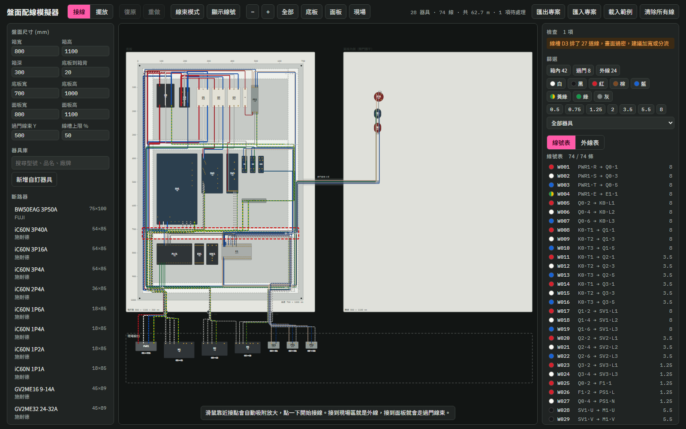

# 盤面配線模擬器

在瀏覽器裡排電控箱：放器具、點兩個接點選線徑顏色，線就會沿著線槽自動走好。圖面是 2D 等比例（單位 mm），用來先確認擺盤間距和配線，再動手做。



## 功能

- **接線：** 滑鼠靠近接點會自動吸附放大，點第一點、第二點後選線號、線徑和顏色；點選一條線時，兩端接點上的並線會淡淡亮起（端子台同一片的上下各點算同一個接點），右側列出並線可點選跳過去；沒有中繼點的線自動走線槽：從接點沿出線方向拉出器具外框再進線槽，不從器具本體上穿過；加了中繼點，線一定經過每個中繼點：接點到第一個中繼點、最後一個中繼點到接點照樣自動走線槽，中繼點與中繼點之間照點的位置直接連；中繼點點在線槽裡時，那條線槽沿中繼點的位置走，點在轉角附近時轉角就落在中繼點上。右側可「清除中繼點，改回自動」。線徑和顏色都可以臨時新增（重新整理後從選單移除，已接的線不變；專案用到的線徑會一直留在選單），新線徑的線寬與外徑依現有線徑表推算。
- **線號：** 每條線內部有自己的識別碼，線號只是名稱，可以重複（共點、同電位用同一個號碼）。建線時接點上已有線就預設沿用它的線號；改號時若同電位還有同號的線，可以一起改；整組複製時每個號碼換新，原本同號的複本仍同號。線號相同但電位不相連會警告（多半是打錯）；「同一電位有不同線號」的提示可在盤面設定開啟。線號表照線號排序，重複時警告與清單會加上兩端接點。
- **自動走線：** 依線槽路網找路徑，每條線分配獨立線道，可切換線束模式、依線徑或顏色篩選、高亮單條線。單條線可設定「不進線槽」直接拉線（例如動力線），可加中繼點調整路徑，不計入線槽占用。
- **說明：** 圖面左下角「? 說明」顯示目前操作的提示，不會自動跳出；遇到還沒看過的操作情況時按鈕上出現小紅點，點開看過就消失（記在瀏覽器），可「重設提示紀錄」。各面板與視窗標題旁的「?」可展開該處的說明。
- **檢視模式：** 標題列「檢視」（快捷鍵 V）只能看不能改：可平移縮放、點線或器具看資料、篩選、匯出與列印；拖曳、刪除、新增、復原與設定都停用。下次打開沿用上次的模式。
- **檔案選單：** 「檔案…」裡有匯出專案、匯入專案、列印／PDF、載入範例。
- **左欄收合：** 左欄（盤面設定、器具庫）右上「«」可收合成窄條，窄條上有「器具庫」「盤面設定」按鈕。預設擺放模式展開、接線與檢視模式收合，各模式記住上次的選擇；收合或展開時圖面上的東西留在原位。手機寬度一律展開。
- **盤面設定：** 左側最上方「盤面設定…」開啟視窗，設定電控箱、底板和面板大小、面板模式與線槽上限；按鈕下方顯示目前尺寸。展開圖顯示底板、面板內側與現場區。
- **面板模式：** 「門板」會檢查面板是否蓋住箱體與關門碰撞；「獨立操作台」不檢查尺寸與碰撞；「不使用」會隱藏面板。
- **排盤：** 拖曳或輸入距離移動器具、線槽與出線口，可旋轉器具，選取後顯示上下左右的間距。
- **器具編號：** 擺放模式選取器具後，右側最上方「器具編號」可以改（例如 KA1 改成 CR-01），改編號不影響已接好的線；改成另一台正在用的編號時，可以一鍵把兩台的編號互換。
- **多選：** 擺放模式 Shift＋點加入或移出、Shift＋拖曳空白處框選、Ctrl＋A 全選；選取後可一起拖曳或用方向鍵移動、刪除、各自旋轉、複製（兩端都在選取內的線一起複製並配新線號），以及靠左／水平置中／靠右／靠上／垂直置中／靠下對齊與水平、垂直等距。
- **複製：** 擺放模式按住 Ctrl（Mac 用 Cmd）拖曳器具、線槽、出線口或現場區，就會拖出一個複本；選取後按 Ctrl＋C、Ctrl＋V 也能複製，滑鼠在圖面上時貼在游標處。鋁軌連軌上器具、現場區連區內器具一起複製，導線不複製。
- **附件：** LADN 輔助接點拖到電磁接觸器上會置中裝上（深度相加後再做深度與關門檢查）；MR-BAT6V1SET 伺服電池拖到伺服驅動器上會掛在下方。附件畫成半透明，之後跟著主體移動、複製，重疊不警告。按住 Alt 拖曳或在右側按「拆下」可以拆開。
- **DIN 軌：** 器具拖到 H-66 鋁軌上會以高度中心對齊軌道，並靠齊相鄰器具或軌道端點；按住 Alt 不吸附。移動鋁軌時，軌上的器具一起移動。伺服、濾波器、風扇、再生電阻和接地銅板不吸附。
- **檢查：** 提示器具彼此重疊、關門碰撞、線槽占用率超過上限。線道多到畫面上靠得很近只是顯示問題，不列入檢查，選取線槽時在右側說明。器具可以放在底板、面板、現場區以外（例如箱外板金），不會警告；線槽可以局部切除，器具壓到線槽也不會警告；完全在箱外的器具也不做深度與關門檢查。
- **中繼點優先於出線方向：** 中繼點放在接點出線方向的反方向、而且在那個器具正後方時，線直接從接點往中繼點那邊出線，不先往外拉再繞回來；沒有中繼點的線照原本方向。線在中繼點前後沿原路折返時，檢查清單會提示移動中繼點。
- **線號位置：** 選取一條線後，可以把線號沿著線拖到想要的位置（線改路徑時跟著移）。線的詳細資料可選線號標在起點端、終點端、中間或兩端都標，選回來就取消拖曳過的位置。
- **二極體：** 器具庫有通用「二極體」（接點 A 陽極、K 陰極，本體畫二極體符號，旋轉也對），可以自己拉線接到任何地方；「二極體（線圈用）」拖到繼電器座或接觸器上會自動裝上、轉向，並自動接到線圈兩端（K 接 +、A 接 −，線號沿用線圈上已有的號碼），拆下時自動接的線一起移除。型號可以每台自訂，材料表照型號列，預設寫「二極體」。二極體接反、或接在 AC 線圈上，檢查清單會提示；線圈極性（A1／14 為 +）可在器具資料勾選對調。
- **同電位器具：** 接地銅板（或名稱有「銅排、共點排、接地排」的自訂器具）所有接點本來就同電位，接在不同孔的同號線不會被當成打錯號碼；器具資料可以逐台勾選或取消「全部接點本來就同電位」。
- **電纜：** 右側「電纜」分頁可以新增電纜（箱內的隔離線、接到現場的外部電纜都可以），規格從電料清單選，或填自訂規格（例如 `0.75mm²*7C 號碼`），芯數、線徑和芯線顏色會從規格解析，每一芯的名稱與顏色也可以改。接芯線有兩種方式：在芯線表點一列、用下拉選單選兩端接點；或按「在圖上接芯線」（芯線表每一列也有「圖上接」）直接在圖上點兩個接點，一芯接完自動換下一芯；接線時圖上的工具列可以跳過這一芯、回上一芯或按「完成」，Esc 也能停止。沒接的芯列為備用。芯線名稱、線號、顏色直接在芯線表裡改，勾選多芯可一次改顏色，也可以依規格重設顏色；勾兩芯可以「互換接線」，展開某一芯可以「改接到另一芯」（芯線顏色不動，兩端接點與線號對調或搬過去）；「依芯線順序重排線號」可以連續編號或用前綴＋芯線名稱；外被、路徑、剝線點等設定收在下方可展開的分區。電纜外被畫成粗灰線，從 A 端剝線點走到 B 端剝線點；芯線只畫剝線點到接點那一段。選取電纜後雙擊外被可以加中繼點、拖曳白點調整、雙擊白點刪除，也可以勾選外被不進線槽；電纜本來就能走線槽外，外被穿過其他器具不警告。剝線點（白色小方塊）預設自動放在最近的線槽裡，拖曳可以移動（移過的變黃色），在電纜資料可改回自動。外部電纜可填現場長度，材料表與線長統計的電纜長度＝外被＋最長芯＋現場長度＋預留。舊檔裡外線上的電纜編號會自動組成電纜。
- **外線：** 從箱內接點接到現場區的接點時，建線視窗可以填電纜編號，會編進那條電纜（沒有就新建）的下一芯。裝在箱體外面的器具（例如箱頂的端子台、回生電阻）和箱內器具之間的線，也會經過出線口進出箱體。拉外線時點一下出線口，就指定這條線走那個出線口；現場設備（或箱外器具）可以設定「預設出線口」，接到它的外線和電纜都走那個。出線口（電纜固定頭、浪管接頭）可裝在箱底、箱頂、左右兩側，拖曳會吸到最近的箱面；外線從出線口沿箱外繞到現場區。
- **現場區：** 可以新增多個現場區（例如依機台或區域分開），拖曳左上角名稱移動整區，區內器具一起移動；可改名、調整大小。外線表會列出現場端所在的現場區。
- **材料表：** 器具、線槽（含支數）、出線口、電線（依線徑與顏色）、電纜（依規格）。
- **線長統計：** 依線徑、顏色、種類與電纜統計條數與長度，可設定每條預留長度。
- **匯出與列印：** 線號表、電纜表、材料表、線長統計都能匯出 CSV；「檔案…→列印／PDF」會輸出全圖、底板、面板與每個有器具的現場區圖面（A4 橫向）和各表格（A4 直向），在列印視窗選「另存為 PDF」就是 PDF。
- **端子台端子號：** 選取 WAGO 2202 端子台後，右側每片一格填端子號（例如 R、S、T、101…），也能一鍵依序編號。端子號只用來顯示，改號碼不影響已接好的線；片數照樣可以增減。
- **短路片：** 選取 WAGO 2202-1401、2202-1201 端子台後，在右側「短路片」選上排或下排插槽、起始片與 2P～5P 加入；畫在端子台中間偏上或偏下，同一排不可重疊，上下排可以重疊；被接起來的幾片算同一個電位（並線亮起、線號檢查都會照算），材料表依規格統計 2002-402～405。重疊或超出片數會擋下或警告。
- **器具庫：** 內建施耐德、士林、三菱、台達、WAGO 等器具，可自訂或修改器具與接點。
- **清除：** 「清除…」選單可選只清除線、清除器具和線，或全部清空（含線槽與出線口）；確認後才刪除，可按復原。箱體尺寸、面板設定、現場區與自訂器具都會保留。
- **存檔：** 自動暫存在瀏覽器，也可匯出、匯入 JSON 專案檔。

## 使用方式

不需要安裝或編譯。下載後直接用瀏覽器開啟 `index.html` 即可，也可以用本機伺服器：

```bash
python -m http.server 8000
```

然後開啟 <http://localhost:8000>。

### 走線測試

修改走線相關程式（`js/routing.js` 等）後先執行 `node tests/route-check.js`；修改介面後執行 `node tests/layout-check.js`，在手機到桌機寬度下打開各種選單與視窗，檢查有沒有超出畫面。走線測試：

```bash
node tests/route-check.js
```

會在固定情境（範例電控箱、T 字接法線槽、旋轉器具、附件、側面出線口、箱內隔離線與外部電纜、出線口四面進出（現場區在箱子上方或下方）等）檢查每條線：沒有警告的線不可穿過其他器具、自動路徑照接點方向出入線、手動路徑經過每個中繼點、不可來回折返；電纜的芯線要接到剝線點，芯數與長度要正確。後面可以再加專案 JSON 檔一起檢查。全部通過才發布。

### 發布到 GitHub Pages

每次修改後先執行 `python3 scripts/bump-version.py` 再推上去：它會更新 `index.html` 裡 css/js 網址後面的版本號，避免瀏覽器拿到快取的舊檔；版本號是發布當下的時間戳（秒），也會顯示在左側面板。


1. 把這個專案推到 GitHub。
2. 到 repository 的 **Settings → Pages**。
3. **Source** 選 **Deploy from a branch**，分支選 `main`，資料夾選 `/ (root)`，再按 **Save**。

## 專案結構

```text
index.html         頁面結構
css/style.css      樣式
js/inventory.js    不畫成器具的電料清單（品名、規格、型號、品牌）
js/devices.js      基礎資料與器具庫（尺寸、接點）
js/sample.js       範例電控箱
js/state.js        專案狀態、暫存、復原
js/routing.js      線槽路網與自動走線
js/render.js       SVG 繪製
js/panels.js       左右面板與檢查清單
js/popup.js        建線彈窗
js/cable.js        電纜資料：規格解析、芯線、剝線點自動位置
js/cables-ui.js    電纜分頁、芯線表、在圖上接芯線、剝線點拖曳
js/report.js       材料表、線長統計、CSV 與列印
js/interact.js     滑鼠、鍵盤與按鈕操作
js/multi.js        多選、對齊、整組複製
js/editor.js       器具編輯器
tests/route-check.js  走線回歸測試
js/main.js         啟動
```

沒有框架，也沒有建置步驟。腳本依 `index.html` 列出的順序載入，並共用全域變數，所以調整順序時要留意相依關係。

新增內建器具時，在 `js/devices.js` 加一筆 `def(...)`，或直接在頁面上用「新增自訂器具」。

## 資料準確度

**這是規劃工具，不能取代原廠資料與實際量測。** 內建的 81 種器具中：

- 49 種的整體尺寸有來源（原廠資料、外型圖或商品頁），其餘 32 種尚未核對，其中 16 種是現場區的示意器具。
- 40 種的接點位置對照過照片或外型圖，只對到區塊與順序，接點之間的實際距離不準。
- 接點編號請以實物和原廠接線圖為準。

滑鼠停在器具上可以看尺寸來源。

線長是圖面估算值：沿畫面上的路徑量，不含彎曲與端子處理；散線的外線只算到出線口，現場段要另外量；電纜可以填現場長度一起計算。過門線束的長度依展開圖的間隔計算，和實際鉸鏈位置有關，下料前請實測。

## 商標

文中的廠牌與型號屬於各自的權利人，僅用來識別器具。本專案與這些廠商沒有關聯。
